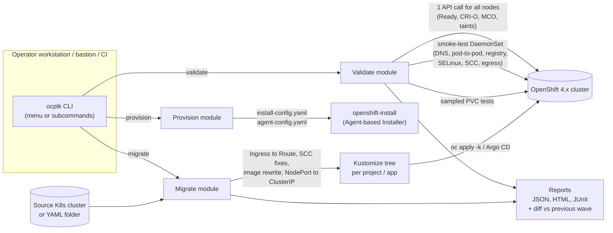

# ocp-toolkit (`ocptk`)

[](https://github.com/GhislainAdon/ocp-toolkit/actions/workflows/ci.yml)


[](LICENSE)

> A single static Go binary that helps platform teams **move workloads and nodes from vanilla Kubernetes to Red Hat OpenShift 4.x at scale**: validate migrated nodes, generate installer configs, and convert K8s manifests into OpenShift-ready, GitOps-friendly Kustomize trees.

[Résumé en français](#résumé-en-français) · [Documentation complète en français](docs/README.fr.md)

---

## The problem

Migrating a large Kubernetes estate (thousands of nodes) to OpenShift fails in predictable places:

- workloads that hard-code `runAsUser` / `fsGroup` are **rejected by the `restricted-v2` SCC**;
- `Ingress` objects, `NodePort` services and public image registries need rewriting (Routes, ClusterIP, internal mirror);
- after each migration wave, someone has to prove that **every node** is healthy (DNS, pod-to-pod, registry, SELinux, CSI), and sequential checks don't scale to 5,000 nodes;
- air-gapped installs need a correct `install-config.yaml` / `agent-config.yaml` with mirror and trust-bundle sections.

`ocptk` packages these checks and transformations into one tool with **dry-run by default**, idempotent `apply`, and timestamped JSON / HTML / JUnit reports.

## Architecture



`ocptk` deliberately shells out to `oc` / `kubectl` (no client-go) so it behaves exactly like the operator's CLI, honours existing kubeconfigs and works behind registry mirrors.

## Features

| Module | What it does |
|---|---|
| **`validate`** | Control-plane checks in one API call (Ready, pressure, CRI-O runtime, MachineConfig state, role labels/taints) **plus an in-node smoke-test DaemonSet** running under `restricted-v2` (DNS, service network, cross-node pod-to-pod, internal registry, egress, SELinux `container_t`, effective SCC). Optional sampled CSI PVC tests. Parallel log collection (`--parallel`, default 30). Degrades gracefully without `cluster-reader`. |
| **`provision`** | Interactive wizard (or `--answers file.yaml` for CI) generating a validated `install-config.yaml`, an `agent-config.yaml` skeleton, an install README and a replayable answers file (secrets excluded, `0600` permissions). Air-gap sections (`imageDigestSources`, `additionalTrustBundle`) when a mirror is declared. |
| **`migrate`** | Reads a YAML folder **or** a live cluster and emits a per-project / per-application **Kustomize** tree ready for Argo CD: `Ingress` to `Route`, namespace to project annotations, SCC detection and `--fix-scc`, image rewrite / `--registry-mirror`, `NodePort` to `ClusterIP` (`--fix-nodeport`), storage-class mapping. Privileged / hostPath / hostNetwork are **always flagged, never auto-fixed**. |
| **Cross-cutting** | `--dry-run` by default, `--confirm` to act; idempotent (`apply` + `app.kubernetes.io/managed-by: ocp-toolkit`); structured logs in `./logs/`; reports in JSON + HTML + JUnit with a **wave-to-wave diff** (regressions, new failures, fixes). |

Validated end-to-end on a **Red Hat Developer Sandbox** cluster: a legacy app with a hard-coded `runAsUser` was rejected by the SCC, `ocptk migrate --fix-scc` rewrote it, `oc apply -k` brought it to `1/1 READY` with a Route, and `validate` covered all 11 nodes through the DaemonSet without `cluster-reader`.

## Quickstart

### Container image (bundles `oc`, nothing else to install)

```bash
docker pull adon1996/ocp-toolkit:latest     # or: docker build -t adon1996/ocp-toolkit:latest .

# Log in (OpenShift console -> your user -> "Copy login command")
mkdir -p .kube work
docker run --rm -v "$PWD/.kube:/root/.kube" --entrypoint oc adon1996/ocp-toolkit:latest \
  login --token=<token> --server=https://api.<cluster>:6443

# Read-only health check + HTML report
docker run --rm -v "$PWD/.kube:/root/.kube" -v "$PWD/work:/work" \
  adon1996/ocp-toolkit:latest validate
# -> work/reports/validate-<ts>/report.html

# Export a namespace and convert it to an OpenShift-ready Kustomize tree
docker run --rm -v "$PWD/.kube:/root/.kube" -v "$PWD/work:/work" \
  adon1996/ocp-toolkit:latest migrate --from-cluster --namespaces my-app \
  --fix-scc --fix-nodeport --confirm

oc apply -k work/generated/migrate/<project>/<app>/base
```

### From source

```bash
make build        # bin/ocptk for the current OS
make test         # go vet + unit tests
make release      # linux/amd64+arm64, windows/amd64, darwin/arm64
./bin/ocptk       # interactive menu
```

### In-cluster (Job)

```bash
oc apply -f deploy/k8s/rbac.yaml -f deploy/k8s/job-validate.yaml
```

### More examples

```bash
ocptk validate --confirm --tolerate-all
ocptk validate --confirm --node-selector node-role.kubernetes.io/worker= \
  --pvc-storageclass ocs-storagecluster-ceph-rbd --egress-target proxy.corp:3128
ocptk provision --answers answers.yaml
ocptk migrate --source-dir ./exports --fix-scc --fix-nodeport --confirm
ocptk migrate --from-cluster --namespaces shop,billing \
  --image-rewrite docker.io=registry.apps.ocp.corp/mirror --confirm
```

## Screenshots

> _Placeholders, to be added (see [docs/screenshots](docs/screenshots/))._

| Interactive menu | `validate` HTML report | `migrate` report |
|---|---|---|
| `docs/screenshots/menu.png` | `docs/screenshots/validate-report.png` | `docs/screenshots/migrate-report.png` |

## Tech stack

- **Go 1.24+** (built with 1.26), [cobra](https://github.com/spf13/cobra), `gopkg.in/yaml.v3`; no other dependencies, static binary (`CGO_ENABLED=0`)
- **OpenShift 4.x / Kubernetes**: `oc`, SCC `restricted-v2`, MachineConfig, Routes, Agent-based Installer
- **Kustomize / Argo CD**-ready output
- **Container**: multi-stage build to UBI 9 minimal + `oc` from `origin-cli`
- **CI**: GitHub Actions with gofmt, `go vet`, `go test -race`, golangci-lint, cross-compilation, Docker build and a Trivy image scan (gating)

### Why Go rather than Python?

A single static binary is easy to ship to an air-gapped bastion (no venv, no PyPI mirror). The image adds only a small binary on top of UBI. Goroutines make it cheap to collect results from thousands of DaemonSet pods, and most OpenShift tooling (`oc`, `openshift-install`, Argo CD) is written in Go.

## Project layout

```
cmd/ocptk/                 entrypoint
internal/cli/              interactive menu + cobra subcommands
internal/common/           kube (oc wrapper), logging, report (JSON/HTML/JUnit/diff), ui
internal/validate/         module 1: API checks + embedded smoke-test DaemonSet
internal/provision/        module 2: embedded installer templates
internal/migrate/          module 3: export + transform/ (unit-tested transformers)
deploy/k8s/                RBAC + Job for in-cluster runs
```

## Roadmap

- [ ] Publish multi-arch images and release binaries from tagged releases (GoReleaser)
- [ ] Unit tests for `validate` result parsing and `provision` template rendering
- [ ] Optional `client-go` backend for environments without `oc`
- [ ] Secret handling in `migrate`: emit SealedSecrets / ExternalSecrets instead of plain `Secret` manifests
- [ ] Prometheus metrics / OpenTelemetry export for wave dashboards
- [ ] Integration with MTC / Crane for stateful volume migration

## Security notes

- `migrate --from-cluster` can export `Secret` objects. Treat the `generated/` folder as sensitive (it is git-ignored).
- `provision` writes the pull-secret to `install-config.yaml` with mode `0600` and a local `.gitignore`.

---

## Résumé en français

**ocp-toolkit** est un outil CLI en Go (binaire statique unique) qui accompagne la **migration de Kubernetes vanilla vers OpenShift 4.x à grande échelle**. Il a trois modules :

- **validate** : contrôles API et DaemonSet de smoke-test sur chaque nœud (DNS, pod-à-pod, registre, SELinux, SCC), avec rapports JSON/HTML/JUnit et diff entre vagues ;
- **provision** : génération validée de `install-config.yaml` / `agent-config.yaml`, y compris en air-gap ;
- **migrate** : conversion des manifestes K8s en arborescence Kustomize par projet et par application, prête pour Argo CD (Ingress→Route, corrections SCC, réécriture d'images, NodePort→ClusterIP).

L'outil fonctionne en dry-run par défaut, il est idempotent et il a été testé sur Red Hat Developer Sandbox. Documentation détaillée : [docs/README.fr.md](docs/README.fr.md).

## License

[MIT](LICENSE) © Ghislain Adon
